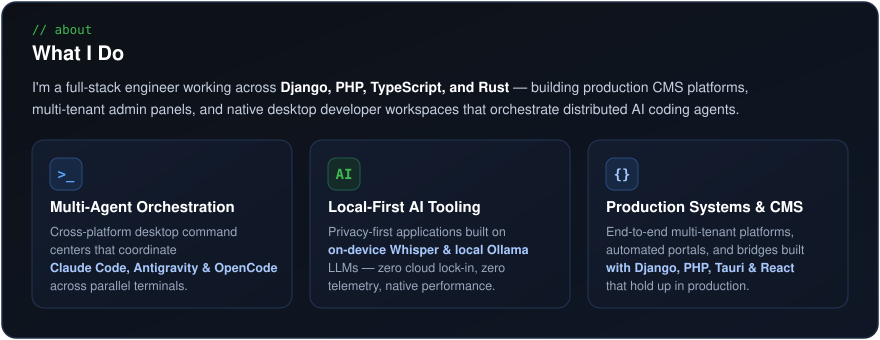
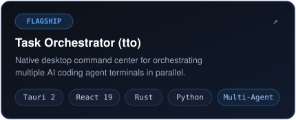
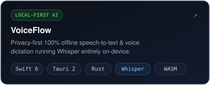
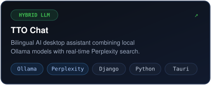

  <!-- Hero Banner -->
  

   

  <!-- About & 3 Pillars -->
  

   

  <!-- Featured Open-Source Projects Header -->
  

  <!-- Clickable 2x2 Project Cards Grid -->
  <table>
    <tr>
      <td width="50%" align="center">
        
      </td>
      <td width="50%" align="center">
        
      </td>
    </tr>
    <tr>
      <td width="50%" align="center">
        
      </td>
      <td width="50%" align="center">
        
      </td>
    </tr>
  </table>

   

  <!-- Tech Stack Card -->
  

   

  <!-- Footer Banner -->
  

