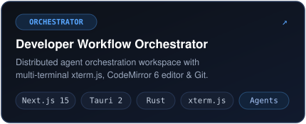
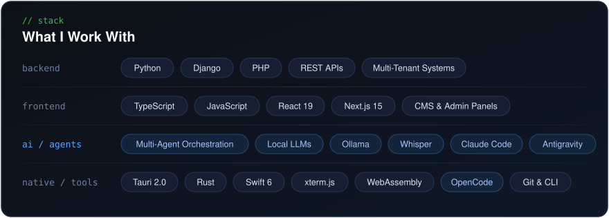
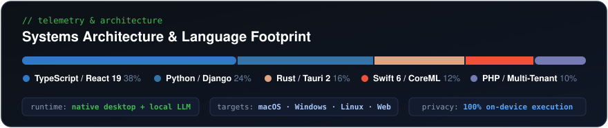

  <!-- Hero Banner -->
  

    

  <!-- About & 3 Pillars -->
  

    

  <!-- Featured Open-Source Projects Header -->
  

  <!-- Clickable 2x2 Project Cards Grid (Borderless) -->
  

    
    
  

  

    
    
  

   

  <!-- Tech Stack Card -->
  

    

  <!-- Systems Architecture & Language Footprint Card -->
  

    

  <!-- Footer Banner -->
  

